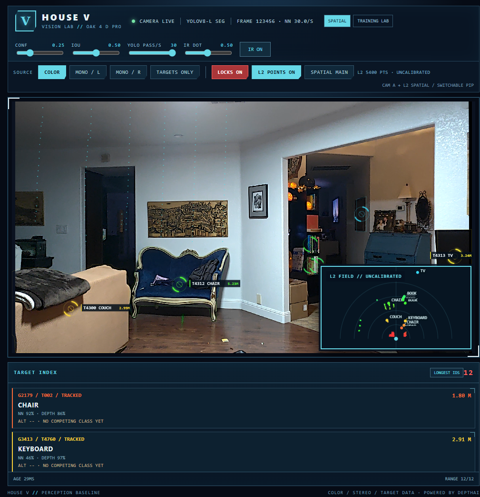
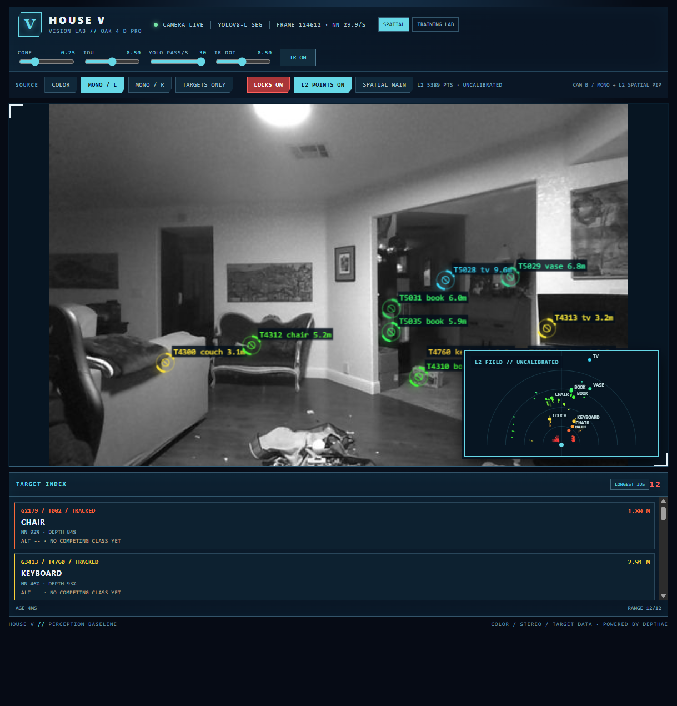
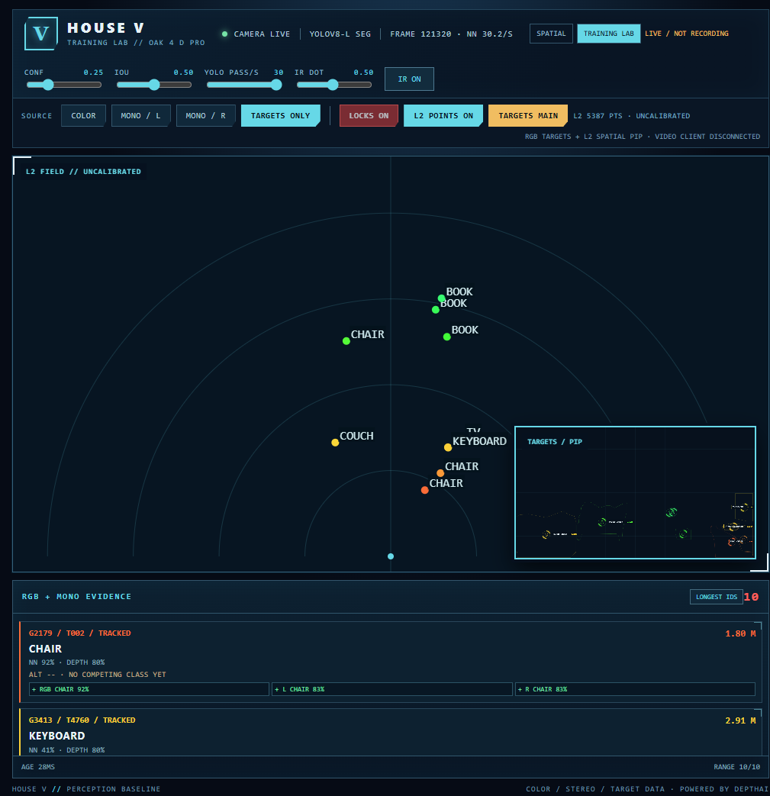
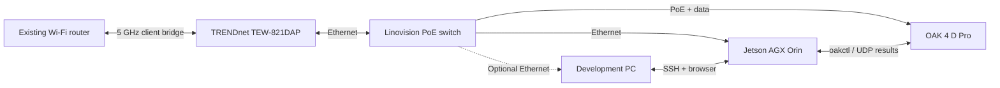

# OAK 4 CV Playground

A hands-on vision lab built around a Luxonis OAK 4 D Pro and a Jetson AGX
Orin. The camera handles real-time image inference, stereo range, and video;
the Orin receives compact observations and maintains provisional object IDs.
House V is the browser interface for comparing views and models. This is an
experimental portfolio project: labels, distances, and IDs still need
labeled-scene evaluation.

**Current release:** v0.9.3 runs on the OAK and is enabled for boot. The
tested v0.9.2 and v0.8.15 apps remain installed for rollback. The two browser
modes below share one installed camera pipeline. They are different ways to
inspect its results, not independently deployed apps.

## Mode 1 — Vision Lab

The [spatial viewer](http://127.0.0.1:8082/) shows YOLOv8 Large instance
segmentation, stereo-derived range, short-term tracks, and an unaligned
Unitree L2 preview. Switch among Color, Left mono, Right mono, and Targets
Only. Any source can swap with the top-down spatial field between the main
pane and picture-in-picture (PiP). Targets Only disconnects H.264 delivery to
that browser while inference and stereo continue on the camera.



The mono views show their own grayscale camera frames and calibration-projected
RGB target centers. They do not copy RGB masks to a different camera's image.



The target index retains the camera track ID (`T`) and Orin provisional global
ID (`G`) for debugging. Spatial dots use object names. A `G` number is an ID
attempted across camera track churn, not a confidence score.

## Mode 2 — Training Lab

The Training Lab tab in the [same House V page](http://127.0.0.1:8082/)
uses the same camera and PiP controls without opening another viewer. It adds
independent YOLOv6 Nano detections on the left and
right mono cameras. The target index shows `+` when a geometrically matched
mono detection names the same class as RGB, `−` when it names a different
class, and `?` when no current match is available. Raw model scores remain
separate; the display does **not** calculate a fused probability.



Screenshots were captured from the live v0.9.2 viewer on 2026-10-26;
displayed class names are model outputs, not hand-verified labels.

The Orin's current global-ID matcher still relies on RGB track geometry,
class, and time. The mono matches shown here are candidate evidence. Nearby
objects and overlapping boxes can create false associations. The page says
`LIVE / NOT RECORDING` because capture, human corrections, training, and
train/validation/test evaluation are not implemented yet. The
[Mode 2 pipeline design](docs/mono-fusion-pipeline.md) describes that work.

## Measured capacity so far

| Path | Current observation | What it establishes |
| --- | --- | --- |
| RGB OAK model | YOLOv8 Large segmentation at 640×352 input, about 30 result passes/s in the live room | The present full-scene RGB pipeline sustains its selected rate in this scene. |
| Mono OAK models | One YOLOv6 Nano stream per 640×400 grayscale camera, resized to 512×288 model input and configured for 10 passes/s each; a 5-second sample saw 47 left and 49 right distinct timestamps | Both additional detector paths run alongside RGB and stereo. This does not measure their class accuracy. |
| Stereo and video | 640×400 stereo at the 30 FPS camera target; 2560×1408 H.264 at a 30 FPS and 60 Mb/s encoder target | The video bitrate is a configured target, not a constant measured transfer rate. |
| Orin and network | Compact UDP results to the identity service; Orin `eno1` negotiated 1 Gb/s full duplex to the PoE switch | The wired link carries aggregate traffic. 60 Mb/s is about 6% of nominal 1 Gb/s link speed before overhead and other streams. The wireless bridge is the uplink, not the camera-to-Orin data path. |
| Unitree L2 | About 12 point clouds/s in an earlier live check; sampled returns are relayed to the browser | The displayed LiDAR field is an uncalibrated preview, not fused object geometry. |

These are throughput observations, **not a measured spare-compute budget**.
OAK neural, CPU, memory, temperature, and per-stage latency utilization have
not been profiled with this full pipeline; neither has sustained thermal
behavior. Browser decoding and Orin processing can also bottleneck a future
configuration independently of Ethernet bandwidth. Before adding another
layer, record those metrics and compare RGB/mono pass rates, end-to-end
latency, dropped frames, and accuracy on the same labeled scenes. Luxonis
documents RVC4's [neural and vision hardware](https://docs.luxonis.com/hardware/platform/rvc/rvc4),
but its peak benchmarks are not a measurement of headroom in this app.

## Next experiments

The first Mode 2 follow-up is **cross-camera identity fusion**: preserve every
RGB/left/right observation, synchronize by source timestamp, reject ambiguous
matches, and use the evidence to keep one object ID through occlusion and
camera-track resets. Compare ID switches and false merges against the current
RGB-only Orin matcher before allowing mono votes to change an identity.
The [fusion tracking issue](https://github.com/kenner1-unlv/Oak-4-CV-playground/issues/2),
[experiment menu](docs/experiments.md), and [pipeline design](docs/mono-fusion-pipeline.md)
set out the evaluation plan.

The next vision layer need not be another COCO object detector. Candidates
with distinct jobs are:

| Candidate | New information | First useful test |
| --- | --- | --- |
| [Feature tracking / optical flow](https://docs.luxonis.com/software-v3/depthai/depthai-components/nodes/feature_tracker/) | Motion and stable image features on the mono pair | Do features help reattach an object after a detector drops it? |
| [Neural stereo depth](https://docs.luxonis.com/software-v3/depthai/examples/neural_depth/neural_depth/) | A learned depth estimate alongside classical stereo | Compare range coverage and error on plain walls, dark fabric, and reflective objects. |
| [Human pose](https://github.com/luxonis/oak-examples/blob/main/neural-networks/pose-estimation/human-pose/README.md) | Body keypoints rather than another person box | Measure whether pose adds useful orientation or motion cues for people. |
| Scene surfaces | Floor, wall, and obstacle regions rather than COCO object classes | Build a labeled indoor scene set and compare mask boundaries before semantic LiDAR projection. |

These are options for separate trials, not models claimed to run together
today. A fixed camera-to-L2 mount, measured transform, and timestamp alignment
are needed before assigning camera labels to LiDAR points.

## The lab

| Component | Role |
| --- | --- |
| [Luxonis OAK 4 D Pro AF](https://docs.luxonis.com/hardware/products/OAK%204%20D%20Pro) | RVC4 camera with RGB, stereo mono pair, IR dot projector; the device reports Luxonis OS 1.45.0. |
| NVIDIA Jetson AGX Orin Developer Kit | Builds and installs `.oakapp` packages, receives compact result records, and hosts the identity and L2 relays. |
| Linovision POE-SW508G2 | PoE power and wired gigabit fan-out for the camera, Orin, and bridge. |
| TRENDnet TEW-821DAP | 5 GHz client bridge from the wired equipment to the existing wireless router. |
| Development PC | Runs the browser through an SSH tunnel or connects directly to the wired subnet. |



See [lab setup](docs/lab-setup.md) for addressing and access details.

## Run it

Build then install through the Orin with `oakctl`; the
[app guide](apps/spatial-segmentation/README.md) has exact commands and
rollback IDs. Close the desktop OAK Viewer while the app owns the camera
pipeline. From the development PC, forward the House V page and color video's
WebSocket:

```powershell
ssh -N -L 127.0.0.1:8082:192.168.50.60:8082 -L 127.0.0.1:8765:192.168.50.60:8765 sauce@192.168.1.2
```

Open `http://127.0.0.1:8082/` and switch Vision Lab / Training Lab in the
page header. Switching those panels keeps the current color-video connection;
Color alone mounts the video viewer, and hidden tabs release it. The
**RECONNECT RGB** button reloads only the viewer if video frames stop while
scene results continue. Old `/training` bookmarks redirect to `/#training`.
Confidence, IoU, and projector settings reset to app defaults on restart.

## Repository map

| Path | Contents |
| --- | --- |
| [Camera app](apps/spatial-segmentation/) | Segmentation, mono detectors, stereo range, House V views and controls. |
| [Architecture](docs/architecture.md) | Processing graph, result records, streams, and limits. |
| [Training Lab design](docs/training-lab.md) | Recording, review, and train/validation/test direction. |
| [Experiment menu](docs/experiments.md) | Dense-scene benchmark and candidate pipelines. |
| [Resolution comparison](docs/resolution-experiment.md) | Earlier scan and video trials. |
| [Orin bridges](bridges/README.md) | Identity and sampled Unitree L2 relay setup. |

## Known limits

- Full-scene RGB inference downsamples to 640×352 and loses small or distant
  detail. The mono detector uses a color-trained model on grayscale input;
  its class scores have not been calibrated for this scene.
- Global IDs are provisional. Geometry-only reattachment can merge lookalike
  objects, and the current per-camera `+`/`−` evidence can match a nearby box.
- Stereo range can fail on reflective, textureless, or occluded surfaces.
  The L2 overlay is not calibrated to the camera or robot frame.
- Quantitative class accuracy, ID switches, false merges, distance error,
  dropped-frame rate, and end-to-end latency need labeled recordings.
