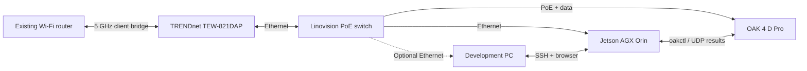

# OAK 4 CV Playground

A hands-on computer vision lab built around a Luxonis OAK 4 D Pro camera. This
repository is a home for **separate, installable camera pipelines**: each app
should answer a specific question, expose its measurements, and document what
worked in a real scene. The first app combines instance segmentation, stereo
range, short-term tracking, and a live browser view.

This is an experimental portfolio project. Detection labels and distances are
measurements to evaluate, not safety decisions.

## The lab

| Component | Role | Verified details |
| --- | --- | --- |
| Luxonis OAK 4 D Pro AF | Runs the vision pipeline on the camera | RVC4; color autofocus camera, stereo mono pair, IR illumination and dot projector. The unit reports `OAK4-D R9` and Luxonis OS `1.45.0`. [Hardware specifications](https://docs.luxonis.com/hardware/products/OAK%204%20D%20Pro) |
| NVIDIA Jetson AGX Orin Developer Kit | Build and deployment host; receives compact result records | ARM64 Linux, connected to the camera over wired Ethernet. The model runs on the OAK, not on the Orin. |
| Linovision POE-SW508G2 | Wired fan-out and PoE power | Eight gigabit RJ45 ports; the installed switch powers the camera and wireless bridge. [Switch specifications](https://support.linovision.com/portal/en/kb/articles/poe-sw508g2) |
| TRENDnet TEW-821DAP | Wireless uplink for the wired equipment | Configured as a 5 GHz **client bridge** to the existing wireless router. It is not acting as a second access point. [Bridge modes](https://www.trendnet.com/products/product-detail?prod=115_TEW-821DAP) |
| Development PC | Browser viewer and optional direct Ethernet access | Reaches the Orin over the home network or connects to the wired camera subnet. |



The bridge gives the wired setup a route to the home network and internet.
The camera-to-Orin inference/result path stays on Ethernet. The Orin builds
`.oakapp` packages with `oakctl`, installs them on the OAK, and listens for
small JSON detection records. The browser can switch between color, both mono
cameras, and target-only metadata. [Lab setup](docs/lab-setup.md) has the current addressing and access
commands.

## App 01: spatial segmentation and view modes

[Source and deployment guide](apps/spatial-segmentation/README.md) ·
[architecture and result format](docs/architecture.md)

1. The RGB camera supplies a 1920×1056 H.264 viewer stream at 30 FPS.
2. A separate 1280×704 inference image is split into four quadrants. One
   640×352 quadrant is sent to **YOLOv8 Large instance segmentation** each
   frame, rotating through the image. Each region refreshes about 7.5 times
   per second at the 30-pass target.
3. Stereo depth is aligned to RGB. Valid points **inside each instance mask**
   produce camera-relative X/Y/Z and range; poor depth leaves range unknown.
4. A short-term tracker holds IDs and class evidence between quadrant visits.
   The viewer shows mask outlines, rounded targeting brackets, and compact
   labels with model score and depth coverage.
5. A House V browser page switches between **Color video**, **Left mono**,
   **Right mono**, and **Detections only**. An independent detection toggle
   hides or shows overlays on the camera views. Color has full masks and boxes;
   mono has red target markers projected from calibrated 3D positions.
6. Confidence, IoU suppression, and IR dot-projector controls work live. The
   Orin can consume timestamped JSON results over UDP.

Version **0.5.2** is running and enabled for boot. A 120-frame check delivered
**30.1 result passes/s**, evenly across the four quadrants. The browser
displayed both mono cameras and the original color view. Detections only
removes the video viewer from the page and polls target JSON; a 40-poll sample
measured **0.473 Mbps of HTTP response payload**. The color video view has
shown about 37 Mbps in this room. These are runtime checks, not an accuracy
benchmark. The app does **not** save video or recordings.

## Mode 01: detections and camera off

[Source and deployment guide](apps/spatial-segmentation/README.md) ·
[tracking issue #1](https://github.com/kenner1-unlv/Oak-4-CV-playground/issues/1)

This is a browser mode in App 01. It draws red target locks and mask outlines
on a dark canvas aligned to the color camera. Selecting it **disconnects the
H.264 viewer from that browser**, reducing client traffic; the camera sensors,
model, stereo pipeline, and encoder remain active so switching back to video
is immediate. The earlier green wall-line experiment was not accurate enough
to keep. The dense-object pile in [the experiment plan](docs/experiments.md)
remains the next evaluation.

## Run it

Install the app through the Orin with `oakctl app build` followed by
`oakctl app install`. The [app guide](apps/spatial-segmentation/README.md)
contains the commands and runtime settings. The standalone desktop
OAK Viewer should be closed while an app owns the camera pipeline.

We use an SSH tunnel for the browser page and color video's WebSocket. The
`localhost` URL gives H.264 the required browser context:

```powershell
ssh -N -L 127.0.0.1:8082:192.168.50.60:8082 -L 127.0.0.1:8765:192.168.50.60:8765 sauce@192.168.1.2
```

Visit **http://127.0.0.1:8082/**. Change the addresses and SSH account for
another network. Confidence, IoU, and projector settings reset to app defaults
on restart; the projector defaults to 0.50 intensity on this Pro camera.

## Repository map

```text
apps/
  spatial-segmentation/   Segmentation, spatial tracks, camera/view controls
docs/
  architecture.md         Processing graph, records, and limitations
  lab-setup.md            Hardware, network, build, and viewer setup
  experiments.md          Pipeline candidates and evaluation questions
scripts/
  oak4-result-listener.py UDP inspection and FPS samples on the Orin
  oak4-update.sh          Verify/apply a Luxonis OS OTA on the Orin
```

## Where this goes next

Each new pipeline should live in its own `apps/` directory with a clear task,
model/depth configuration, sample output, and measured tradeoffs. Candidates
include better scene geometry, object-centric 3D localization,
open-vocabulary detection, motion and identity tracking, and eventually
fusion with a Unitree L2 lidar. See the
[experiment menu](docs/experiments.md). We will compare candidates against
labeled scenes and report accuracy, latency, frame rate, and network cost
before calling any one of them an improvement.

## Known limits

- A 30 FPS video stream does not mean every pixel is analyzed at 30 Hz; each
  quadrant is visited about 7.5 times/s.
- IDs are short-term associations, not re-identification after long occlusion.
- Class labels can be wrong, and stereo range can fail on reflective,
  textureless, or occluded regions. The on-screen model score is distinct from
  valid depth coverage.
- Quantitative detection accuracy, identity stability, distance error, and
  end-to-end latency still need a labeled evaluation set.
