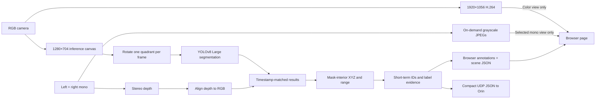

# Pipeline architecture

The OAK 4 D Pro runs the model and stereo pipeline. The Orin builds/installs
the app and optionally consumes metadata; it does not process browser video.
One camera app provides several switchable browser views.



The source is in [spatial-segmentation](../apps/spatial-segmentation/). A DepthAI
Script node rotates the model crop through four quadrants. The parser emits a
mask, box, class, and score for each instance. The ResultNode pairs those
outputs with an organized RGB-aligned point cloud and tile ID. It samples
valid 3D points inside a shrunken mask, then uses a robust median for X/Y/Z
and range. The in-memory tracker associates detections between visits to a
quadrant and accumulates class evidence before changing a displayed label.

The browser page on port 8082 proxies the color Visualizer, which uses a
WebSocket on port 8765. Confidence and IoU sliders send
`DetectionParserConfig` messages to the native parser's input queue. IoU here
controls **model non-maxima suppression**; it does not change the tracker's
separate association threshold. The control values are process state, so they
reset when the app restarts.
The House V page creates the color Visualizer only while Color video is
selected. Detections only removes that iframe and polls scene JSON to draw red
boxes and masks on a dark canvas. The encoder stays active in the camera graph
for fast switching, but H.264 is no longer delivered to that browser.
Left/right mono views request JPEGs on demand and can show or hide projected
3D target-center markers. They do not reuse the color masks because the
cameras have different optical centers, fields of view, and image geometry.
The calibration transforms RGB-frame XYZ into each mono camera frame before
projection. Markers with invalid depth or outside the mono image are omitted.
The built-in IR dot projector is commanded to 0.50 intensity at startup and
can be adjusted live independently of the display mode.

## Streams and browser delivery

| Data path | Purpose | Leaves the camera? |
| --- | --- | --- |
| RGB inference canvas → one tile → YOLO | Classes, boxes, instance masks | No raw tile frames |
| RGB color + left/right mono → stereo/RGBD | Align depth and measure mask-interior 3D points | No raw depth or point cloud |
| RGB NV12 → H.264 encoder | 1920×1056 color video | Delivered only while Color video view is selected |
| Annotation topic | Color-aligned masks, brackets, labels, range | Displayed with the Color video view when detections are on |
| Left/right mono JPEGs | Grayscale diagnostic camera views | Only the selected mono frame is JPEG-encoded on request |
| Scene JSON | Boxes, mask outlines, IDs, range, projected mono target centers | Polled by Detections only and by mono views when overlays are on |
| UDP result records | Compact detection/track metadata | Yes, to the Orin when configured |

The YOLO COCO classes do not produce wall geometry. A green depth-edge
prototype was tried and rejected because stereo noise yielded unhelpful room
lines. Accurate wall geometry and calibrated lidar fusion remain future work.

## Result record

When `ORIN_RESULT_HOST` is set, the app sends one UDP JSON datagram per model
pass to `ORIN_RESULT_HOST:8766` (override the port with `ORIN_RESULT_PORT`).
An example shape, with illustrative values:

```json
{
  "schema_version": 1,
  "frame_id": 1234,
  "tile_id": 2,
  "device_timestamp_ns": 123456789,
  "objects": [
    {
      "track_id": 7,
      "label": "chair",
      "detector_label": "chair",
      "detector_score": 0.92,
      "bbox_xyxy_norm": [0.25, 0.5, 0.45, 0.9],
      "xyz_mm": [120, 20, 1850],
      "range_m": 1.854,
      "depth_valid_fraction": 0.8,
      "depth_spread_mm": 45,
      "track_state": "tracked",
      "age_frames": 0,
      "tile_parts": 1
    }
  ]
}
```

`xyz_mm` and `range_m` are `null` when depth is insufficient. `detector_score`
is a class/model score; `depth_valid_fraction` and `depth_spread_mm` describe
depth sampling quality. `track_state` is `tracked` for a direct observation
in the current pass and `held` for a recent track displayed between passes.
The UDP record contains boxes and measurements, **not** image frames or mask
pixels. Color masks are visualized through the browser annotation topic or
outline coordinates in the detection-only HTTP scene record. Mono HTTP scene
records add projected center markers, without changing the UDP contract.

## Performance and limitations

At a 30 FPS video target, the model executes 30 tile passes/s and visits each
quadrant about 7.5 times/s. The app does not record video. A live 120-frame
sample on the current scene measured 29.99 result passes/s, with 30 passes for
each tile; the browser reported 30 FPS network/decode/render. These numbers
do not measure end-to-end latency or inference accuracy.

The tracker holds identities through short gaps but has no appearance model
for re-identification after long occlusion. A segmentation mask can be wrong
even when its model score is high. Stereo distance can be missing or biased
by texture, reflectivity, calibration, and occlusion. The
[experiment plan](experiments.md) is intended to measure those failure modes.
