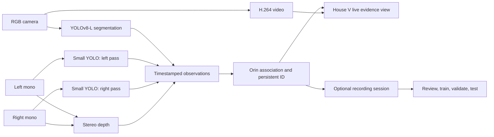

# Mode 2 pipeline: RGB and mono identity fusion

This is the proposed pipeline for the second House V mode. Its **default**
state is a live, non-recording view: three camera models report observations,
the Orin assigns one scene-level ID, and the viewer shows which observations
support or contradict the current label. Recording adds an explicit data
capture and correction workflow; it is not required for live synchronization.
The existing spatial-segmentation mode remains the performance baseline.

## Data flow



The two mono passes use the **same lightweight model and weights**, with each
inference labeled by camera socket. The v0.9.0 trial loads two network nodes
for a simple independent timing check; sharing one loaded model with tagged
passes is a later resource optimization. Start with a measured target of 10 passes/s per mono
camera while retaining the RGB baseline; neither combined throughput nor
mono accuracy is assumed. A small color-trained YOLO on grayscale images is
only a candidate. Benchmark it on actual mono captures, then adapt or train
for grayscale if needed. If the OAK cannot sustain the combined graph, retain
mono capture on the OAK and move the small detector to the Orin as a measured
alternative.

RGB remains the source of instance masks and mask-interior range. Left/right
mono contribute boxes, class evidence, and additional observations through
brief RGB occlusions. Stereo depth still uses the mono pair. A mono detector
box is not a segmentation mask, and the current mono projected RGB-center
marker is not an independent mono detection.

## Synchronization and association

1. Preserve each camera frame's device timestamp, sequence number, socket,
   actual image transform, model input transform, and calibration version.
   Associate results with their *source frames*, then group observations
   within a measured timestamp window. Record skew; do not invent a three-way
   group if a pass is missing.
2. Use rectified stereo geometry and depth to test left/right candidates.
   An epipolar match is a gate, not proof that two boxes cover the same
   object: object centers, occlusion, and differently sized boxes can differ.
3. Project candidate 3D positions into RGB using the calibrated camera
   transforms. Check class compatibility, position/size consistency, depth,
   time since observation, and whether both objects can coexist. Allow a
   mono-only provisional track when RGB has no matching mask.
4. The Orin associates this evidence to its persistent global ID. Two
   simultaneous spatially distinct objects cannot share one ID. Keep a
   competing hypothesis when a match is ambiguous instead of forcing a merge.
5. Fuse class evidence over time with per-model calibration and freshness.
   Report each raw score separately. Before held-out calibration exists,
   display agreement and disagreement, **not** a numeric fused probability.

An unmatched mono result is negative evidence only if the object was expected
in that camera's field of view, unobscured, and the corresponding inference
completed. Out-of-frame, stale, dropped, or occluded results are `unknown`.
This avoids lowering confidence because a model never saw the object.

## Versioned result contract

The v0.9.0 trial keeps the version-1 RGB UDP record and adds matched
`mono_evidence` fields per RGB track. Independent mono detections that do not
match an RGB track are not yet sent to the Orin. The planned full fusion
contract introduces a separate version-2 observation stream with one record
per completed model pass; the Orin joins observations and publishes fused
tracks. An illustrative future record:

```json
{
  "schema_version": 2,
  "camera": "left",
  "socket": "CAM_B",
  "frame_sequence": 1234,
  "device_timestamp_ns": 123456789,
  "calibration_id": "camera-calibration-hash",
  "model_id": "mono-detector-version",
  "image_transform_id": "rectified-640x400-letterbox",
  "inference_status": "complete",
  "detections": [
    {
      "local_detection_id": 7,
      "class_id": 56,
      "label": "chair",
      "raw_score": 0.73,
      "bbox_xyxy_norm": [0.2, 0.3, 0.5, 0.8]
    }
  ]
}
```

The corresponding Orin response includes `global_id`, observation IDs,
match state (`matched`, `ambiguous`, `unmatched`), per-camera age and geometric
residuals, class evidence by model, and optional `fused_score` only after its
calibration method and version are specified. Preserve unmatched detections
for debugging and later annotation. Raw captures and human corrections are
stored separately from predictions.

## Default House V view: live, not recording

The familiar main pane switches **Color / Mono L / Mono R / Targets only**;
spatial PiP and the existing range-colored reticles remain. One selected
global ID is highlighted across views when projection is geometrically
supported. Mono views show their own detector boxes and the projected RGB
track as visually distinct marks, so disagreement is inspectable.

The target index is sorted by closest tracked object, with the existing
longest-lived-ID view available. Each row shows the current ID and label,
range, track age, and an evidence strip:

| View | Example display | Meaning |
| --- | --- | --- |
| RGB | `+ CHAIR 0.91` | Current segmentation observation supports chair. |
| Left | `+ CHAIR 0.73` | Current independent mono observation supports chair. |
| Right | `− COUCH 0.62` | Current mono observation matched this object but favors couch. |
| Any | `? OUT OF VIEW` or `? STALE` | No valid current vote; not a negative. |

The header reads `LIVE / NOT RECORDING`, synchronization health, latest
per-camera pass age, and camera/model versions. A small counter shows matched,
ambiguous, and unmatched observations. A live event line can show `ID
REATTACHED`, `CLASS DISAGREEMENT`, or `DEPTH UNAVAILABLE`. No training metric
or `+/-` evidence is fabricated before mono model results exist. The current
`AWAITING MODEL` placeholder remains until then.

## Recording and evaluation state

`START SESSION` explicitly begins synchronized capture on the Orin. The same
live view remains visible while a recording bar adds session name, duration,
disk consumption, dropped frames, skew, and review queue count. `STOP` closes
the manifest. Review allows same/different ID, wrong class, and uncertain
corrections without rewriting raw observations. Train/validation/test runs
consume versioned session splits and show metrics in a separate experiment
panel. A candidate fusion model runs in shadow mode before it can replace the
baseline association logic. See [Training Lab](training-lab.md) for split and
evaluation rules.

## Build order and acceptance checks

1. Add tagged mono frames/results and measure synchronization, dropped passes,
   video FPS, RGB inference FPS, mono inference FPS, and Orin load. Validate
   grayscale class accuracy on labeled stills before using mono votes.
2. Add version-2 result transport and an Orin joiner. Check that projected
   observations remain associated with the same physical object across all
   three camera views and report unmatched/ambiguous cases.
3. Add the default evidence view. Confirm `+`, `−`, and `?` come from real,
   timestamped model results; camera switching and PiP retain their behavior.
4. Add opt-in recording, immutable manifests, corrections, and session-level
   train/validation/test splits. Compare ID switches, false merges, label
   changes, and recovery after occlusion against the existing baseline.

The v0.9.0 trial code includes independent mono detector passes and a live
evidence view. It does not yet implement the version-2 observation contract,
mono-only provisional tracks, fusion training, or recording. Actual device
performance and matching quality must be measured after installation.
