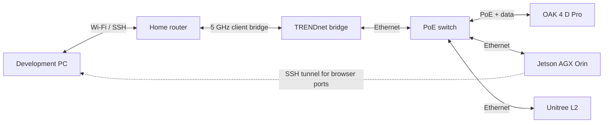
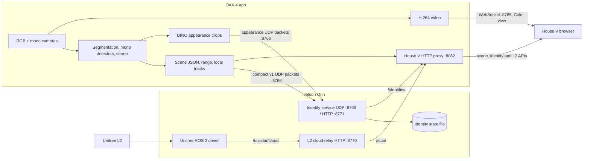

# OAK, Orin, and L2 system map

This page maps the **current source and observed Orin service state** as checked
on 2026-11-13. It complements the [camera pipeline](architecture.md), which
details inference inside the OAK app. The OAK app's live installed version was
not rechecked for this document; repository source alone is not deployment
proof.

## Physical and network paths

The camera, Orin, and L2 share the wired side. The bridge is an uplink for
remote access; OAK-to-Orin result packets do not need the wireless hop. The
example addresses and tunnel command are in [lab setup](lab-setup.md). Check
them on the actual devices before using them because network state can change.

## Running data and control paths

The Orin receives result metadata and appearance vectors; it does not decode
or process House V's color video. The browser reaches the camera page on port
8082 and the video WebSocket on 8765, normally through the documented SSH
tunnel. The OAK-side proxy returns Orin identity and L2 data through that same
HTTP origin.

| Flow | Producer and code | Consumer and code | Current meaning |
| --- | --- | --- | --- |
| Scene and track record, UDP 8766 | [OAK result node](../apps/spatial-segmentation/main.py) | [Orin identity service](../bridges/orin_identity.py) | Boxes, labels, stereo range, provisional camera track IDs and matched mono evidence; no images or raw depth |
| Appearance vector, UDP 8766 | [OAK DINO stage](../apps/spatial-segmentation/main.py) | [Orin identity service](../bridges/orin_identity.py) | Similarity evidence for a track; it does not change global IDs |
| Identity response, HTTP 8771 | [Orin identity service](../bridges/orin_identity.py) | [OAK control proxy](../apps/spatial-segmentation/model_controls.py), then [House V](../apps/spatial-segmentation/housev.js) | Provisional global ID mapping and recent identity summaries |
| L2 cloud, ROS 2 topic | External Unitree SDK2 driver | [Orin L2 relay](../bridges/l2_cloud_relay.py) | Sampled, uncalibrated point cloud |
| L2 scan, HTTP 8770 | [Orin L2 relay](../bridges/l2_cloud_relay.py) | [OAK control proxy](../apps/spatial-segmentation/model_controls.py), then [House V](../apps/spatial-segmentation/housev.js) | Visual preview, with no camera labels assigned to points |
| Color video, WebSocket 8765 | OAK encoder/Visualizer | House V browser | Browser-only H.264 delivery when Color is selected |

## What code belongs to this repository

- [orin_identity.py](../bridges/orin_identity.py) receives compact OAK
  datagrams, assigns provisional global IDs from geometry, class, and time,
  stores DINO candidate similarity, and persists compact state under the
  configured Orin data path.
- [l2_cloud_relay.py](../bridges/l2_cloud_relay.py) subscribes to the Unitree
  ROS cloud, samples finite XYZ points, and serves the latest scan. It does
  not calibrate or fuse L2 with camera detections.
- [oak4-result-listener.py](../scripts/oak4-result-listener.py) is a diagnostic
  UDP receiver for result rate and payload checks. It binds the same default
  port as the identity service, so run it only when that listener is stopped
  or on a separate configured port.
- [oak4-update.sh](../scripts/oak4-update.sh) is an Orin-side OAK OS update
  helper. Its check and verify modes inspect the exact camera/artifact;
  applying an OTA is a separate device operation.
- [housev-identity.service](../bridges/systemd/housev-identity.service) is the
  checked-in unit matching the persistent Orin user service. The
  [L2 driver](../bridges/systemd/housev-l2-driver.service) and
  [relay](../bridges/systemd/housev-l2-relay.service) units document the
  currently transient launch commands as **templates**. They have not been
  installed or enabled by this documentation change.
- The Unitree SDK2 ROS driver under the Orin's ROS workspace is upstream
  vendor code, not repository-owned code. Diagnostic `inspect_*.py` files and
  historical app build directories in `/data/oak4` are experiments, not
  active Orin services; they are not copied into this public source tree.

Read-only checks on 2026-11-13 found the identity service active and the L2
driver and relay active as transient user units. The deployed
`/data/oak4/orin_identity.py` matched the repository bytes; the L2 relay
matched after CRLF-to-LF normalization. These checks establish source parity
for those files at that time, not current OAK app identity or end-to-end sensor
accuracy.

## Known boundaries and next implementations

1. **Independent observations and identity:** The current version-1 UDP scene
   includes mono evidence matched to RGB tracks; unmatched mono detections
   are not yet a complete independent stream. [Issue #2](https://github.com/kenner1-unlv/Oak-4-CV-playground/issues/2)
   and the [fusion design](mono-fusion-pipeline.md) cover a version-2
   observation contract, ambiguous matches, and labeled ID-switch testing.
2. **Labeled accuracy:** [Issue #1](https://github.com/kenner1-unlv/Oak-4-CV-playground/issues/1)
   covers the dense-scene detection/range benchmark. Existing live pass-rate
   observations are throughput evidence, not class or distance accuracy.
3. **OAK-to-L2 calibration:** [Issue #9](https://github.com/kenner1-unlv/Oak-4-CV-playground/issues/9)
   calls for source/receipt timestamps, a measured rigid transform, reference
   distances, and error reporting before attaching camera labels to L2
   returns. Today's overhead view remains a heuristic preview.
4. **Service lifecycle:** The identity user service is persistent; the
   checked Orin L2 driver and relay are transient. Validate the unit templates,
   boot order, health checks, and recovery on the actual Orin before replacing
   those transient launches.

The separate [LEGO CV lab](https://github.com/kenner1-unlv/lego-cv-lab) trains
its own piece detector from reviewed images. It does not depend on the Orin
identity service or on L2 fusion.

## Where mmWave radar might fit

| Sensor | Evidence it could contribute here | Main limit for this project |
| --- | --- | --- |
| OAK RGB/stereo | Image class, mask, and camera-relative range | Low texture, reflectivity, lighting, and occlusion can weaken visual/depth evidence |
| Unitree L2 | Sampled 3D scene returns at its own frame and time | The current OAK/L2 view is uncalibrated and has no object labels |
| Candidate mmWave radar | Range, angle, and radial velocity of radar returns | No color or fine image outline; nearby stationary targets may not separate on a selected antenna/configuration |

A future mmWave sensor would add direct radial-velocity evidence and
range/angle detections for moving objects, including when lighting or
visibility hurts cameras. A plausible first trial is **motion/presence and
approach detection** on the Orin alongside OAK tracks, compared against
labeled room sequences. It would need its own timestamped message contract,
mount transform, field-of-view mapping, and measured false-alarm and missed
target rates before affecting identities or safety decisions.

It is not a LEGO piece classifier. Radar does not supply color or camera-like
instance outlines, and separation of nearby stationary targets depends
strongly on antenna aperture and processing. No radar device is selected or
integrated in this repository. See TI's
[range and angular resolution guide](https://www.ti.com/lit/ab/swra841a/swra841a.pdf)
and [mmWave sensing overview](https://www.ti.com/document-viewer/lit/html/swra766)
for the sensor tradeoffs behind this proposed trial.
